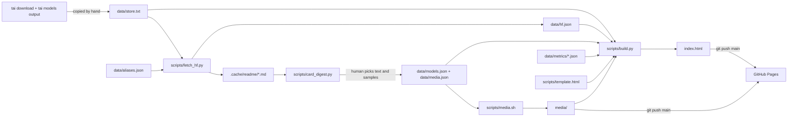

# architecture

How the catalog's data flows from the `tai download` / `tai models` output to the published page.

- **`data/store.txt` is the master list.** Only rows here are rendered. Entries in the other data files for models no longer in the store are ignored, not errors. The first line holds `Updated: YYYY-MM-DD`, which the page footer shows.
- **Keys differ per file.** `aliases.json` is keyed by store *model id* (`Qwen/Qwen3.5-9B-Turbo`); `models.json`, `media.json` and `data/metrics/*.json` are keyed by store *name* (`Qwen3.5-9B-Turbo`). `hf.json` is a list in store order.
- **Aliases:** Tiiny's `-Turbo` builds and renamed models have no Hugging Face page under the store id; `aliases.json` maps them to the original repo, and `null` records "known to have no page". `hf.json` then has `via` set, and the card link reads "Original on Hugging Face".
- **Metrics files** are split by model kind only for editing convenience (`chat`, `generators`, `retrieval`, `speech_ocr`); `build.py` merges them all into one dict, so a name must appear in only one file.
- **Network:** only `fetch_hf.py` (Hugging Face API and raw READMEs) and `media.sh` (sample URLs) touch the network. `build.py` is offline and deterministic.
- **`.cache/`** (gitignored) holds model cards and raw sample downloads; it can be deleted and refilled with `make fetch` / `make media FORCE=1`.
- **Deploy:** there is no CI build. GitHub Pages serves `index.html` and `media/` straight from `main`, so the built files must be committed with the data change.
